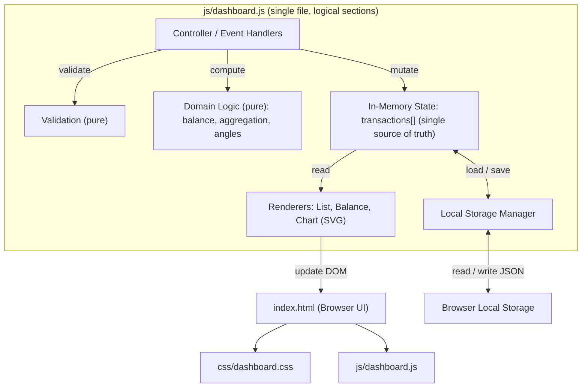

# Design Document: Todo List Life Dashboard

## Overview

The Todo List Life Dashboard is a client-side-only web application for recording and managing personal expense transactions, presented with the visual aesthetic of an online shop storefront. It is built from self-contained static files — one HTML page, exactly one CSS file in `css/`, and exactly one Vanilla JavaScript file in `js/` — with no build step and no runtime dependency on any external server or CDN. All data is persisted in the browser through the Local Storage API.

The Dashboard exposes four components: an **Input Form** to add a transaction (item name, amount, category), a scrollable **Transaction List** that shows every stored transaction and lets the user delete any entry, a **Total Balance Display** shown prominently at the top of the page, and a **Visual Chart** rendering a pie chart of spending distribution by category. The pie chart is rendered with hand-rolled SVG drawn directly from the application data — no third-party chart library is used — so the application satisfies the "no external resources at runtime" and "exactly one JavaScript file" requirements without compromise.

The same static bundle runs in three deployment contexts: opened directly as a local `file://` page, served by GitHub Pages, and packaged as a Manifest V3 browser extension whose popup points to the same `index.html`.

## Research Summary

Two areas were researched before design:

1. **Charting approach.** Chart.js (current stable v4.4.x) is conventionally loaded from a CDN and updated via `chart.update()` ([Chart.js – Getting Started](https://www.chartjs.org/docs/latest/getting-started/), [Chart.js – Pie Chart sample](https://www.chartjs.org/docs/latest/samples/other-charts/pie.html)). However, the approved requirements forbid external runtime resources (Requirement 7.3) and network requests to an external server when run as a local file (Requirement 6.2), and constrain the project to exactly one JavaScript file in `js/` (Requirement 10.2). A CDN load, a vendored library file, and a bundling build step each conflict with at least one of those clauses. A hand-rolled SVG pie chart avoids all three conflicts while keeping the chart logic in pure, testable functions. This is the chosen approach.

2. **Browser extension packaging.** A Manifest V3 extension renders its UI from a static HTML page declared as the action popup, using standard HTML/CSS/vanilla JavaScript with no special tooling ([Mozilla – WebExtensions Popups](https://developer.mozilla.org/en-US/Add-ons/WebExtensions/user_interface/Popups.), [freeCodeCamp – Build a Chrome extension with Manifest V3](https://freecodecamp.org/news/how-to-build-a-chrome-extension-using-javascript-and-manifest-v3)). Because the Dashboard only uses the Local Storage API — which is available to an extension popup under its own origin — no extension permissions are required beyond the manifest itself.

Key findings that shaped the design:
- The pie chart can be produced entirely from pure functions (category aggregation, angle computation) plus SVG arc paths, making it suitable for property-based testing.
- Browser extension packaging is a thin wrapper (a `manifest.json`) around the same static bundle; it does not change the core architecture.
- Floating-point safety matters for monetary sums, so totals are rounded with an epsilon-based technique and amounts are validated using string-based decimal-place checks.

## Architecture

The application is a single-page static bundle with a lightweight **unidirectional data-flow** architecture, written in Vanilla JavaScript with no framework and no external runtime dependencies.

### Architectural Layers



The single source of truth is an in-memory array of `Transaction` objects held in `dashboard.js`. Every mutation (add, delete) updates this array, persists it through the Local Storage Manager, and then triggers a full re-render of the three view components from the updated state. Views never hold their own state; they always derive from the central array.

### Data Flow

```mermaid
sequenceDiagram
    participant U as User
    participant C as Controller
    participant V as Validation
    participant S as State (transactions[])
    participant P as Persistence
    participant R as Renderers

    U->>C: Submit form (itemName, amount, category)
    C->>V: Validate inputs
    alt Invalid (empty/whitespace or bad amount)
        V-->>C: Errors
        C-->>U: Show validation messages; state unchanged
    else Valid
        C->>S: Create Transaction, push to array
        C->>P: saveTransactions()
        alt Persist fails
            P-->>C: Error
            Note over S: Transaction retained in memory
            C-->>U: Show persistence error
        end
        C->>R: renderAll()
        R-->>U: Update Transaction List, Total Balance, Chart
        C-->>U: Clear input fields
    end
```

The same control flow applies to delete: the controller removes the targeted transaction from state, persists, and re-renders; if the targeted id cannot be found (delete failure), the transaction is retained and a failure indication is shown (Requirement 2.6).

### Design Decisions

1. **Hand-rolled SVG pie chart (no library).** Chosen over Chart.js (via CDN or vendored) because it satisfies Requirements 6.2 (no external network requests), 7.3 (no external runtime resources / no build step), and 10.2 (exactly one JS file in `js/`) simultaneously. A pie chart is a direct geometric computation from category totals and is fully expressible as pure functions plus SVG arc paths. *Rationale: maximum self-containment and requirements fidelity.*

2. **Single in-memory source of truth with full re-render.** Rather than incremental DOM patching, each mutation re-renders the list, balance, and chart from the state array. For the expected personal-expense scale (tens to low thousands of entries) this completes well within the 100 ms update target (Requirement 8.2). *Rationale: simplicity and correctness; the small scale does not justify a diffing layer.*

3. **Transaction ID generation.** IDs are generated with `crypto.randomUUID()` where available, with a timestamp-plus-random fallback, ensuring uniqueness without a central counter that could collide after a reload. *Rationale: robust uniqueness for the round-trip and delete-by-id behaviors.*

4. **Monetary precision.** Amounts are stored as JavaScript numbers. Totals are computed with an epsilon-rounded technique (`Math.round((sum + Number.EPSILON) * 100) / 100`) and displayed with two decimals. Decimal-place validation is string-based (counting digits after the decimal separator) to avoid floating-point misclassification of values like `0.1 + 0.2`. *Rationale: Requirements 1.5, 3.2, and 5.5 all depend on reliable decimal handling.*

5. **Optional browser extension manifest at repository root.** `manifest.json` lives at the project root. When the repository is loaded as a browser extension, its `action.default_popup` points to `index.html`; when opened as a web page or via GitHub Pages, the manifest is simply an unused static file. *Rationale: one bundle, three deployment contexts, no duplication.*

## Components and Interfaces

The following table maps the requirements' named components to the implementation. All logic lives in the single `js/dashboard.js` file, organized into logical sections by comment headers.

| Component (requirements) | HTML root | JS functions |
|---|---|---|
| Input_Form | `<form id="transaction-form">` | `handleFormSubmit(event)`, `validateTransactionInput(...)` |
| Transaction_List | `<div id="transaction-list">` | `renderTransactionList(transactions)`, `handleDeleteTransaction(id)` |
| Total_Balance_Display | `<div id="total-balance-display">` | `renderTotalBalance(transactions)`, `computeTotalBalance(transactions)` |
| Visual_Chart | `<div id="visual-chart">` (SVG) | `renderChart(transactions)`, `aggregateByCategory(transactions)`, `computeSegmentAngles(...)`, `describeArc(...)` |
| Local_Storage_Manager | — | `loadTransactions()`, `saveTransactions(transactions)`, `serializeTransactions(transactions)`, `deserializeTransactions(jsonString)` |

### Input_Form

A form `#transaction-form` containing:
- `#item-name-input` — text input, `maxlength="100"` (Requirement 1.1).
- `#amount-input` — text input with `inputmode="decimal"`; numeric parsing and bounds are enforced in JavaScript (Requirement 1.1, 1.5) rather than relying solely on a `number` input, so that exact decimal-place and range validation can be controlled.
- `#category-select` — `<select>` offering exactly Food, Transport, Fun (Requirement 1.2).
- `#submit-button`.
- `#form-validation-message` — element displaying inline validation errors.

**Interface:**
- `validateTransactionInput(itemName, amountString, category) -> { valid: boolean, errors: string[] }` — pure function. Rules (Requirements 1.3–1.5):
  - `itemName` is invalid if its trimmed value has fewer than one non-whitespace character, or if its length exceeds 100 characters.
  - `amountString` is invalid if it is not a finite number, is not positive, has more than two decimal places, or exceeds `999999999.99`.
  - `category` is invalid if it is not one of Food, Transport, Fun.
- `handleFormSubmit(event)` — orchestrates: validate → create → persist → render → clear fields (Requirement 1.6); on invalid input, shows errors and does not mutate state (Requirement 1.4, 1.5).

### Transaction_List

A scrollable container `#transaction-list` (CSS `max-height` + `overflow-y: auto`) holding one row per transaction. Each row displays the item name, amount, and category (Requirement 2.2) and exposes a delete control tagged with `data-transaction-id`.

**Interface:**
- `renderTransactionList(transactions)` — rebuilds the list from state. When the array is empty, it shows the empty-state indication and hides the scrollable list (Requirement 2.5).
- `handleDeleteTransaction(id)` — removes the matching transaction; if none matches (delete failure) the transaction is retained and a failure is indicated (Requirement 2.6); on success it persists and re-renders (Requirements 2.3, 2.4).

### Total_Balance_Display

A prominent element `#total-balance-display` rendered at the top of the page.

**Interface:**
- `computeTotalBalance(transactions) -> number` — pure function returning the sum of all `amount` values rounded to two decimal places (Requirement 3.2). Returns `0` for an empty set (Requirement 3.5).
- `renderTotalBalance(transactions)` — formats the computed total (two decimals, currency-style) into the display. Re-runs on every mutation so it reflects adds, deletes, and any modification (Requirements 3.3, 3.4, 3.6).

### Visual_Chart

A container `#visual-chart` that holds an inline SVG pie chart.

**Interface (pure logic):**
- `aggregateByCategory(transactions) -> { Food: number, Transport: number, Fun: number }` — sums amounts per category; categories with no transactions are `0`.
- `computeSegmentAngles(categoryTotals, grandTotal) -> Segment[]` where each `Segment = { category, total, fraction, startAngle, endAngle }`. `fraction = total / grandTotal`; `angle = fraction * 360` degrees (Requirement 4.1). Categories with zero total are omitted from the visible segments.
- `describeArc(centerX, centerY, radius, startAngle, endAngle) -> string` — produces an SVG path `d` attribute for an arc wedge.
- `renderChart(transactions)` — when there are transactions, builds one `<path>` per present category with a unique fill color and a `<text>` label carrying the category name (Requirement 4.2); when there are no transactions, shows the empty-state message "No spending data is available" and renders no segments (Requirement 4.4). Re-runs on every state change (Requirement 4.3).

Category colors are fixed constants (one distinct color per category) to guarantee unique, stable colors.

### Local_Storage_Manager

**Interface:**
- `serializeTransactions(transactions) -> string` — `JSON.stringify` of the array (Requirement 5.3).
- `deserializeTransactions(jsonString) -> { ok: boolean, data: Transaction[], error: string|null }` — `JSON.parse` plus per-item structural validation (Requirement 5.4); returns `ok: false` on parse or validation failure.
- `saveTransactions(transactions) -> boolean` — writes the serialized string under the storage key; returns `false` if the write throws or is denied (e.g. disabled storage), in which case the in-memory array is retained and a persistence error is surfaced (Requirement 5.7).
- `loadTransactions() -> Transaction[]` — reads on startup; if the key is absent the Dashboard initializes with an empty set (Requirement 5.6); if parsing fails it initializes with an empty set and reports a data-loading error (Requirement 5.8); otherwise it returns the parsed set, which is supplied to the list, balance, and chart (Requirement 5.2).

### Controller / Initialization

- `initDashboard()` — runs on `DOMContentLoaded`: calls `loadTransactions()`, populates state, calls `renderAll()`, and attaches the form-submit and list-delete listeners.
- `renderAll()` — convenience wrapper invoking the three renderers, ensuring the list, balance, and chart are always consistent with state.

### Error Display

- `showFormValidation(errors)`, `clearFormValidation()` — inline validation messages.
- `showPersistenceError(message)`, `showLoadError(message)`, `showDeleteFailure(id)` — non-blocking status banners/toasts.

## Data Models

### Transaction

```typescript
interface Transaction {
  id: string;        // unique identifier (crypto.randomUUID or timestamp+random fallback)
  itemName: string;  // trimmed value has >= 1 non-whitespace char; raw length <= 100
  amount: number;    // finite, > 0, <= 999999999.99, at most 2 decimal places
  category: string;  // one of "Food" | "Transport" | "Fun"
}
```

Constraints enforced by validation (Requirements 1.1, 1.3–1.5):

| Field | Constraint | Validation source |
|---|---|---|
| `itemName` | 1–100 characters; ≥ 1 non-whitespace after trim | `validateTransactionInput` + `maxlength` attribute |
| `amount` | 0.01 ≤ amount ≤ 999999999.99; ≤ 2 decimal places | `validateTransactionInput` (string-based decimal check) |
| `category` | exactly one of Food, Transport, Fun | `<select>` + `validateTransactionInput` |

### Local Storage Schema

A single key holds the entire dataset as a JSON string.

- **Key:** `todoListLifeDashboard:transactions`
- **Value:** JSON array string, e.g.
  ```json
  [
    { "id": "9b1...e3", "itemName": "Lunch", "amount": 12.50, "category": "Food" },
    { "id": "a4f...77", "itemName": "Bus fare", "amount": 3.00, "category": "Transport" }
  ]
  ```
- **Round-trip (Requirement 5.5):** for any set of transactions `T`, `deserializeTransactions(serializeTransactions(T))` yields a set with the same count and matching `id`, `itemName`, `amount`, and `category` values per transaction. JavaScript's `JSON.stringify` produces the shortest representation that round-trips exactly for numbers, so stored amounts parse back to the identical value.

### Pie-Chart Segment Model

```typescript
interface Segment {
  category: string;   // "Food" | "Transport" | "Fun"
  total: number;      // sum of amounts in this category, rounded to 2 decimals
  fraction: number;   // total / grandTotal
  startAngle: number; // degrees, measured clockwise from 12 o'clock
  endAngle: number;   // startAngle + fraction * 360
}
```

The pie chart is drawn as SVG `<path>` wedges using `describeArc`; the category label is rendered as an SVG `<text>` element. With no transactions (or `grandTotal === 0`) the chart shows the empty-state message instead of any wedge (Requirement 4.4).

## UI Layout and Online Shop Theme

The layout uses a card-based, e-commerce storefront aesthetic:

- **Top bar / header:** shop-style banner with the product/title "Life Dashboard".
- **Total Balance Display:** placed at the very top with the largest type. CSS variables set the transaction-entry font size at `16px` and the balance font size at `36px` (a `2.25×` ratio, satisfying the "at least 2×" prominence rule, Requirement 9.2). Body text is `16px`, comfortably above the `14px` minimum (Requirement 9.3). A single font-family stack (system UI font) is applied to every text element (Requirement 9.4).
- **Input Form:** a card styled like an "add to cart" panel — labeled fields, a category selector styled as product-variant chips/select, and a primary "Add Transaction" button.
- **Transaction List:** a scrollable cart-style list. Each row shows the item name, the amount styled as a price tag, a category badge (colored to match the chart), and a remove/delete control. Empty state shows a "No transactions yet" placeholder (Requirement 2.5).
- **Visual Chart:** a storefront-style card containing the SVG pie chart with category labels; empty state shows "No spending data is available" (Requirement 4.4).
- **Consistency:** one accent color, rounded corners, subtle shadows, and uniform spacing across all four components reinforce the single-theme requirement (Requirement 9.1).

Because no external resources may be loaded (Requirement 7.3), typography uses a system font stack (a single family) rather than a web font.

## Folder Structure

```
CodingCamp-16November26-Rafli/
├── index.html                  # single HTML page
├── css/
│   └── dashboard.css            # the single CSS file (Requirement 10.1)
├── js/
│   └── dashboard.js             # the single JavaScript file (Requirement 10.2)
├── assets/
│   └── icons/                   # optional icons for the extension/PWA
├── manifest.json                # optional Manifest V3 file for browser-extension packaging (Requirement 6.3)
├── README.md
└── .kiro/
    └── specs/
        └── todo-list-life-dashboard/
            ├── requirements.md
            ├── design.md
            └── tasks.md
```

Notes:
- The `js/` directory contains exactly one JavaScript file and the `css/` directory contains exactly one CSS file (Requirements 10.1, 10.2). `assets/` and `manifest.json` are not source code and do not count against the single-file constraints.
- `manifest.json` is present at the repository root so the same bundle can be loaded as a browser extension (its `action.default_popup` is `index.html`); it is inert when the project is opened as a web page or served by GitHub Pages (Requirements 6.2, 6.3, 11).
- Indentation width is uniform within each file, and all identifiers use complete meaningful words (no single-letter names, placeholders, or numeric suffixes) (Requirement 10.3, 10.4).


## Correctness Properties

*A property is a characteristic or behavior that should hold true across all valid executions of a system — essentially, a formal statement about what the system should do. Properties serve as the bridge between human-readable specifications and machine-verifiable correctness guarantees.*

The following properties cover the pure-logic behavior of the Dashboard (validation, balance computation, chart aggregation, serialization, list projection, and persistence-on-mutation). UI rendering, visual design, browser compatibility, performance timing, and deployment are addressed in the Testing Strategy with example, integration, and smoke tests instead of properties, since those behaviors do not vary meaningfully with input.

### Property 1: Valid submission creates a matching transaction

*For any* valid input triple (an item name with at least one non-whitespace character and at most 100 characters, an amount in the range 0.01–999,999,999.99 with at most two decimal places, and a category of Food, Transport, or Fun), submitting the Input_Form SHALL increase the stored Transaction count by exactly one, and the new Transaction's `itemName`, `amount`, and `category` SHALL equal the trimmed item name, the parsed amount, and the selected category.

**Validates: Requirements 1.3**

### Property 2: Whitespace-only or empty submissions are rejected

*For any* submission whose required fields are empty or contain only whitespace, the Input_Form SHALL reject the submission, SHALL NOT modify the stored Transactions, and SHALL produce a validation message identifying the offending fields.

**Validates: Requirements 1.4**

### Property 3: Invalid amounts are rejected and valid boundaries are accepted

*For any* amount string that is non-numeric, non-positive, has more than two decimal places, or exceeds 999,999,999.99, validation SHALL reject the submission. Conversely, the boundary values 0.01 and 999,999,999.99 SHALL be accepted.

**Validates: Requirements 1.5**

### Property 4: Successful submission clears the input fields

*For any* valid submission, after the Transaction is successfully added, all Input_Form fields (item name, amount, and category) SHALL be cleared.

**Validates: Requirements 1.6**

### Property 5: The rendered Transaction List faithfully projects stored state

*For any* set of stored Transactions and after any mutation (add or delete), the rendered Transaction List SHALL contain exactly one entry per stored Transaction, and each entry SHALL display that Transaction's `itemName`, `amount`, and `category`. The number of rendered entries SHALL equal the number of stored Transactions.

**Validates: Requirements 2.1, 2.2, 2.4**

### Property 6: Deleting a transaction removes exactly that entry

*For any* set of stored Transactions and any existing Transaction id, deleting that Transaction SHALL remove exactly that entry: the resulting count SHALL be one less, and every other Transaction SHALL remain unchanged.

**Validates: Requirements 2.3**

### Property 7: Total balance equals the rounded sum of all amounts

*For any* set of stored Transactions, the displayed Total_Balance SHALL equal the sum of all `amount` values rounded to two decimal places. This SHALL hold after additions, deletions, and any modification; *for any* empty set, the Total_Balance SHALL be zero.

**Validates: Requirements 3.2, 3.3, 3.4, 3.5, 3.6**

### Property 8: Pie segments are proportional to category totals and one per present category

*For any* set of stored Transactions, the Visual_Chart SHALL produce exactly one labeled segment for each Category whose total spending is greater than zero, each segment SHALL have a unique color, and each segment's angular fraction SHALL equal that Category's total spending divided by the grand total. The segment fractions SHALL sum to one (the angles to 360°).

**Validates: Requirements 4.1, 4.2**

### Property 9: Serialization round-trips with identical field values

*For any* set of Transactions, parsing the JSON string produced by serializing that set SHALL yield a set with the same count and matching `id`, `itemName`, `amount`, and `category` values for each Transaction as the original set.

**Validates: Requirements 5.3, 5.4, 5.5**

### Property 10: Mutations persist the current state to storage

*For any* mutation (addition or deletion), the value written to Browser_Local_Storage SHALL equal the serialization of the current in-memory set of Transactions, so that reloading the Dashboard restores that exact set.

**Validates: Requirements 5.1**

## Error Handling

The Dashboard distinguishes three classes of error and handles each without corrupting the in-memory source of truth:

| Class | Trigger | Requirement | Behavior |
|---|---|---|---|
| Validation error | Empty/whitespace or invalid Amount at submit | 1.4, 1.5 | Reject submission; show inline validation message identifying the offending field(s); do not mutate state. |
| Persistence error | `saveTransactions` throws or is denied (e.g. storage disabled/full) | 5.7 | Retain the updated in-memory set; show a non-blocking persistence-error banner; the UI still reflects the in-memory state. |
| Data-load error | Stored JSON cannot be parsed into valid Transaction objects on load | 5.8 | Initialize the Dashboard with an empty set; show a non-blocking data-loading-error banner. |
| Delete failure | No Transaction matches the targeted id | 2.6 | Retain the affected Transaction in the displayed list; show a delete-failure indication. |

Design rules for error handling:
- Errors never silently discard data. The in-memory array is the authority; persistence is a best-effort mirror. A failed save keeps the current data in memory and visible (Requirement 5.7).
- Every error produces a user-visible indication (inline message or status banner); none is swallowed.
- Validation is performed before any state mutation, so an invalid submission cannot leave the store in an inconsistent state.
- Monetary rounding uses an epsilon-based technique to avoid floating-point drift in error paths just as in the success path.

## Testing Strategy

A dual approach: property-based tests verify the universal logic properties above across many generated inputs, while example/integration/smoke tests cover specific scenarios, UI rendering, cross-browser behavior, performance, and deployment. The pure logic functions (`validateTransactionInput`, `computeTotalBalance`, `aggregateByCategory`, `computeSegmentAngles`, `serializeTransactions`, `deserializeTransactions`, `renderTransactionList`, add/delete operations) are extracted as plain, side-effect-free functions so they can be tested without a DOM where possible; DOM-dependent renderers are tested under a lightweight DOM emulation.

### Property-Based Tests (PBT)

- **Library:** `fast-check` (via a test runner such as Vitest in `--run` mode), chosen for Vanilla JS / ESM compatibility. PBT runs against the pure logic extracted from `js/dashboard.js`; DOM-dependent properties (rendering, form clearing) run under a DOM emulation with mocked `localStorage`.
- **Configuration:** each property test runs a minimum of 100 iterations.
- **Tagging:** each test carries a comment referencing the design property, in the format `Feature: todo-list-life-dashboard, Property N: <property text>`.
- **Mapping** (one property-based test per design property):
  - Property 1 — generate valid input triples; assert add grows the list by 1 with matching fields. **Validates: Requirements 1.3**
  - Property 2 — generate whitespace-only/empty item names; assert rejection and unchanged state. **Validates: Requirements 1.4**
  - Property 3 — generate invalid amounts (non-numeric, ≤0, >2 decimals, >max) and assert rejection; assert 0.01 and 999,999,999.99 are accepted. **Validates: Requirements 1.5**
  - Property 4 — generate valid submissions; assert all fields cleared afterward. **Validates: Requirements 1.6**
  - Property 5 — generate arbitrary transaction sets and mutations; assert the rendered list entries match state (count + fields). **Validates: Requirements 2.1, 2.2, 2.4**
  - Property 6 — generate sets and existing ids; assert delete removes exactly the target. **Validates: Requirements 2.3**
  - Property 7 — generate transaction sets (including the empty set); assert balance equals `round(sum, 2)` and is `0` when empty. **Validates: Requirements 3.2–3.6**
  - Property 8 — generate transaction sets; assert one labeled, uniquely-colored segment per non-zero category and that each segment fraction equals `categoryTotal / grandTotal`, summing to one. **Validates: Requirements 4.1, 4.2**
  - Property 9 — generate transaction sets; assert `deserialize(serialize(set))` deep-equals the set. **Validates: Requirements 5.3–5.5**
  - Property 10 — generate add/delete mutations with a mock storage; assert the written value equals `serialize(currentState)`. **Validates: Requirements 5.1**

### Unit / Example Tests

- Input form fields present with `maxlength=100`; category select has exactly Food/Transport/Fun (Requirements 1.1, 1.2).
- Total Balance Display positioned above the list/chart (Requirement 3.1).
- Empty Transaction List shows the empty-state indication (Requirement 2.5); deleting a non-existent id retains the entry and shows a failure (Requirement 2.6).
- Empty chart shows the "no spending data" message and no segments (Requirement 4.4).
- Absent storage key on load initializes empty with no error (Requirement 5.6); simulated write failure retains the in-memory set and shows an error (Requirement 5.7); corrupt stored JSON initializes empty with a load error (Requirement 5.8).
- Visual design assertions: online-shop theme classes applied (Requirement 9.1); balance computed font-size ≥ 2× a transaction entry's (Requirement 9.2); body font-size ≥ 14px (Requirement 9.3); all text elements share one font-family (Requirement 9.4).

### Integration / Smoke Tests

- Chart re-renders within 2s of a state change (Requirement 4.3); all three views update within 100ms of a mutation (Requirement 8.2); first render within 2s on load (Requirement 8.1).
- Loading via `file://` makes no external network requests (Requirement 6.2); the extension popup renders and interacts without console errors (Requirement 6.3); cross-browser smoke across Chrome/Firefox/Edge/Safari with no console errors (Requirement 6.1).
- The page loads and operates with no install/config steps (Requirements 7.1, 7.2); only local `css/` and `js/` files are loaded, no build step (Requirement 7.3).
- Exactly one `.css` file under `css/` and one `.js` file under `js/` (Requirements 10.1, 10.2); uniform indentation per file (Requirement 10.3); no single-letter/generic/numeric-suffix identifiers (Requirement 10.4).
- GitHub Pages URL responds without auth (Requirement 11.1); a pushed change appears within 10 minutes (Requirement 11.2); a failed push leaves the published site unchanged (Requirement 11.3).

### Test Execution Notes

- Run property and unit tests with a single-execution command (e.g. `vitest --run`) rather than watch mode.
- Cross-browser, performance, and deployment checks are performed manually or in CI against the built static bundle; they are not part of the PBT suite.
- The single `js/dashboard.js` exposes the pure functions (e.g. via module exports guarded for both browser and test contexts) so tests can import them without loading the full page.
